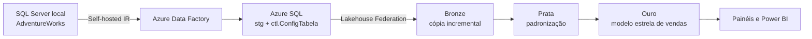

# AdventureWorks Lakehouse

**SQL Server local → Azure SQL → Databricks (bronze, prata e ouro) · AdventureWorks**

Laboratório de engenharia de dados desenvolvido por **Alex Alves**. O Azure Data Factory leva os dados de um
SQL Server local para uma camada de staging no Azure SQL. O Databricks lê esse staging por federação
(Lakehouse Federation) e constrói uma arquitetura medalhão incremental, entregando um modelo estrela de vendas.

## Arquitetura



| Camada | Schema | Conteúdo |
|---|---|---|
| Staging | `azure_adventureworks.stg` (federado) | 71 tabelas copiadas pelo Data Factory |
| Bronze | `workspace.adventureworks_bronze` | Cópia Delta incremental por marca d'água, com upsert |
| Prata | `workspace.adventureworks_silver` | Nomes em snake_case, textos tratados, uma linha por chave |
| Ouro | `workspace.adventureworks_gold` | `fato_vendas`, 5 dimensões e `vw_vendas_detalhadas` |

A tabela `ctl.ConfigTabela`, no Azure SQL, é o contrato entre o Data Factory e o Databricks:
lista as tabelas ativas, o tipo de carga, a coluna de marca d'água e as chaves de cada uma.

## Estrutura do repositório

```text
adventureworks-lakehouse/
├── adf/                    # recursos do Data Factory (integração Git do ADF)
├── databricks/
│   ├── databricks.yml      # bundle e alvos dev e prod
│   ├── resources/          # definição do job
│   └── src/                # notebooks bronze, prata e ouro
├── sql/azure/              # scripts do Azure SQL
├── tests/                  # testes das transformações (pytest)
├── docs/                   # documentação e evidências
└── .github/workflows/      # CI e CD (GitHub Actions)
```

## Documentação

- [Fase 1: ingestão incremental com Azure Data Factory](docs/ingestao_adf.md)
- [Fluxo de desenvolvimento e CI/CD](docs/cicd.md)

## Segurança

Credenciais não entram no repositório. A conexão federada usa um usuário somente leitura no Azure SQL,
com senha guardada apenas na conexão do Databricks. A automação usa segredos do GitHub.

---

**Autor:** [Alex Alves](https://github.com/AlexAlvesInacio)
