# AdventureWorks Lakehouse

**Pipeline de dados de ponta a ponta: SQL Server local → Azure Data Factory → Azure SQL → Databricks (bronze, prata e ouro), com CI/CD no GitHub Actions**


Laboratório de engenharia de dados desenvolvido por **Alex Alves**. Os dados nascem num SQL Server local, são copiados de forma incremental para o Azure pelo Data Factory e transformados no Databricks numa arquitetura medalhão, até virarem um modelo estrela de vendas. Todo o código é versionado, testado e publicado automaticamente, com ambientes separados de desenvolvimento e produção.

O pipeline foi validado com um **teste de ponta a ponta**: uma alteração feita na origem chegou à camada ouro com o valor exato calculado antes da execução.

---

## Destaques

| | |
|---|---|
| **71 tabelas** | copiadas de forma incremental, guiadas por uma única tabela de controle |
| **3 camadas** | bronze, prata e ouro em Delta Lake, todas incrementais ou validadas |
| **121.317 linhas** | na fato de vendas, conferidas automaticamente contra a origem |
| **2 ambientes** | `dev` e `prod` no mesmo workspace, publicados por bundle |
| **CI/CD** | lint, testes, validação e deploy a cada mudança, com Pull Request para a `main` |
| **Teste E2E** | receita esperada de 109.850.575,99, obtida exatamente |

---

## Arquitetura

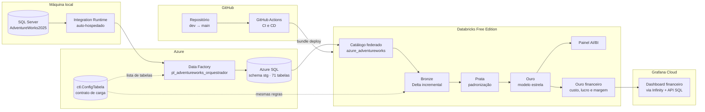

A tabela `ctl.ConfigTabela` funciona como **contrato** entre o Data Factory e o Databricks: lista as tabelas ativas, o tipo de carga, a coluna de marca d'água e as chaves. Incluir ou desativar uma tabela ali muda o comportamento das duas ferramentas ao mesmo tempo.

---

## 1. Origem: SQL Server local

O banco AdventureWorks2025 roda numa instância local do SQL Server, simulando o sistema operacional de uma empresa. A coluna `ModifiedDate`, presente em quase todas as tabelas, é a base da carga incremental.

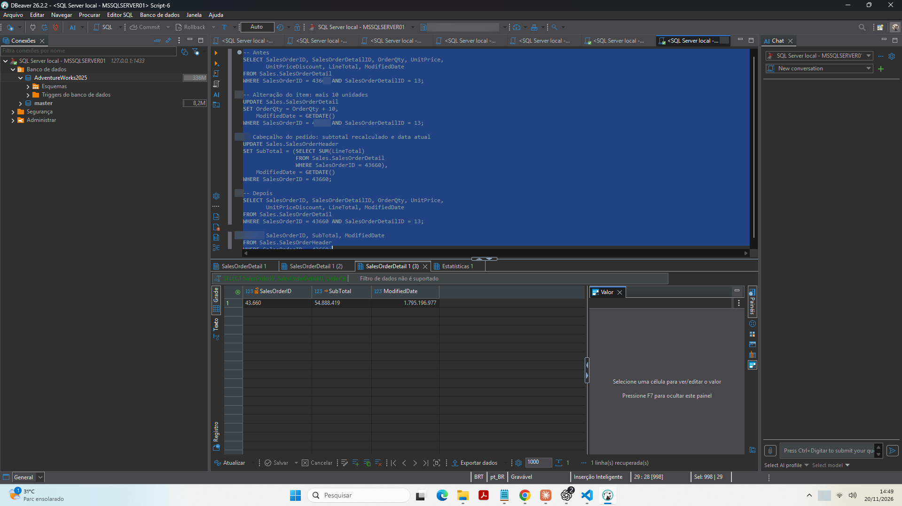

---

## 2. Ingestão incremental com Azure Data Factory

O Data Factory acessa a máquina local por um **Integration Runtime auto-hospedado** e grava no Azure SQL, no schema `stg`.

O pipeline `pl_adventureworks_orquestrador` segue o padrão **orientado por metadados**: um `Lookup` lê as tabelas ativas da `ctl.ConfigTabela` e um `ForEach` executa o pipeline genérico de carga para cada uma.

A técnica é **marca d'água com upsert**: para cada tabela, copia só as linhas com `ModifiedDate` maior que o último marco e grava com upsert pela chave primária, sem duplicar registros.

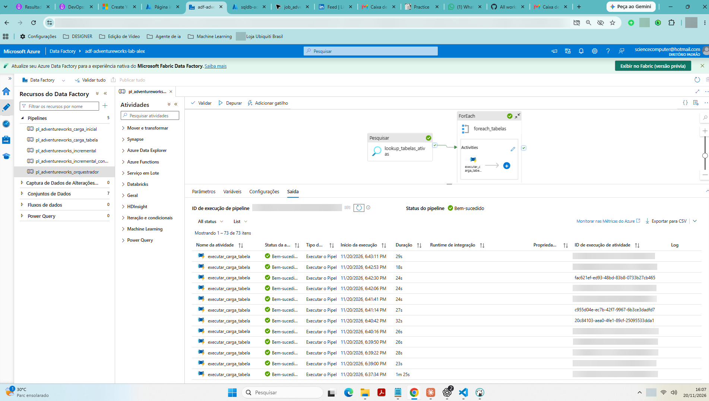

| Execução | Duração |
|---|---|
| Carga inicial completa | cerca de 1 h 40 min |
| Execução incremental (71 tabelas) | cerca de 38 min |

Detalhes da primeira fase: [docs/ingestao_adf.md](docs/ingestao_adf.md).

---

## 3. Lakehouse no Databricks

O Databricks lê o Azure SQL por **Lakehouse Federation**, com um usuário somente leitura, e constrói três camadas em **Delta Lake**.

### Bronze: cópia incremental

O notebook `nb_bronze_incremental` lê a mesma `ctl.ConfigTabela`, calcula o marco próprio da bronze (maior `ModifiedDate` já carregada) e aplica `MERGE` pelas chaves. Tabelas sem marco ou do tipo `FULL` são recriadas. Cada execução é registrada em `log_cargas`, e qualquer falha interrompe o job antes da prata.

### Prata: padronização genérica

O notebook `nb_silver_padronizacao` aplica as mesmas regras às 71 tabelas: nomes em `snake_case`, remoção de colunas técnicas, textos aparados, vazios como nulo e uma linha por chave, com coluna de auditoria.

### Ouro: modelo estrela de vendas

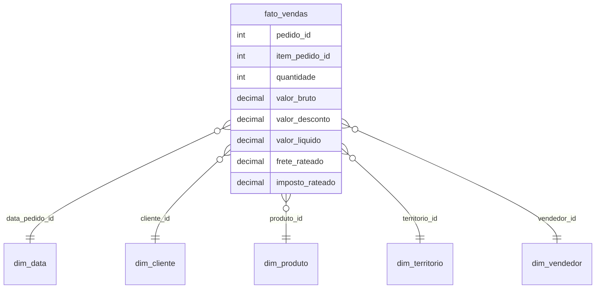

O grão é o **item de pedido**. Frete e imposto do cabeçalho são **rateados** proporcionalmente ao valor líquido de cada item. A `dim_vendedor` tem um **membro desconhecido** (`-1`, "Sem vendedor") para as vendas online. A view `vw_vendas_detalhadas` junta tudo para painéis e Power BI.

O notebook termina com uma **validação automática**: linhas da fato, total líquido e frete precisam bater com a prata, senão o job falha.

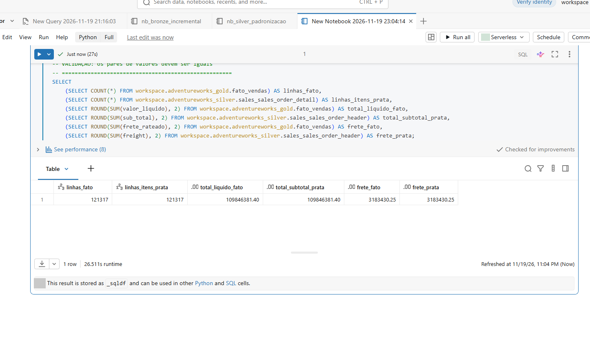

### Orquestração

O job `job_adventureworks_lakehouse` executa as três camadas em sequência, com dependências e uma nova tentativa automática por tarefa.

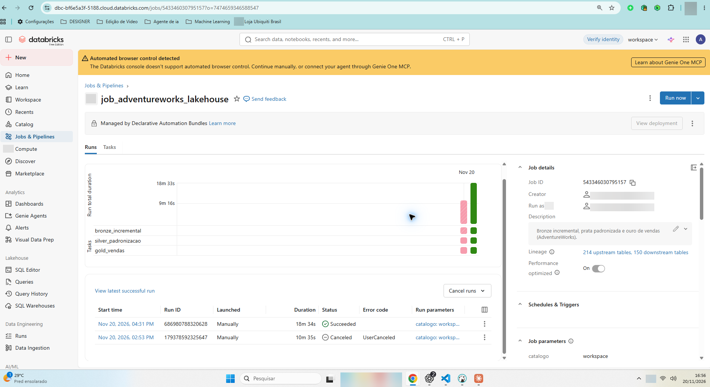

---

## 4. Git e CI/CD

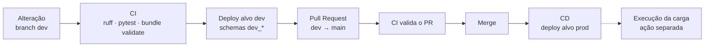

O job e os notebooks são descritos como código com **Declarative Automation Bundles** (antigos Databricks Asset Bundles). O mesmo código atende dois ambientes: os notebooks recebem catálogo e schemas por parâmetros do job, e cada alvo do bundle define seus próprios schemas.

| Alvo | Schemas | Job |
|---|---|---|
| `dev` | `dev_adventureworks_bronze`, `_silver`, `_gold` | `[dev usuário] job_adventureworks_lakehouse` |
| `prod` | `adventureworks_bronze`, `_silver`, `_gold` | `job_adventureworks_lakehouse` |

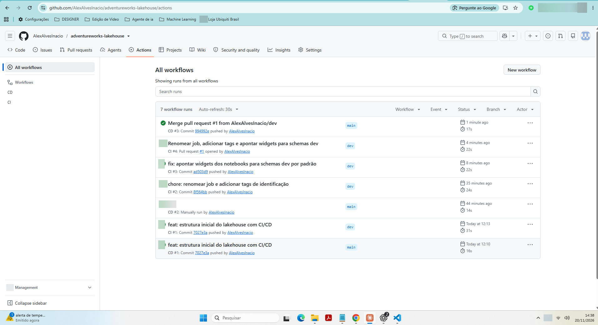

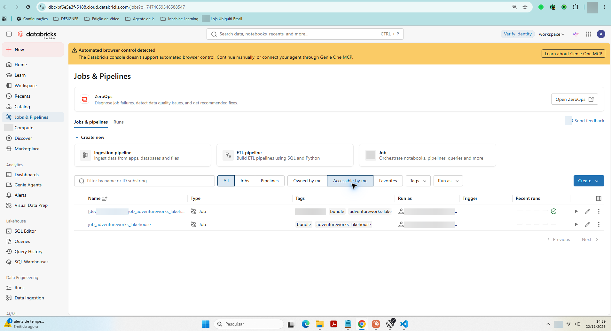

O ambiente `dev` foi validado contra o estável: mesmo número de linhas e mesmo total.

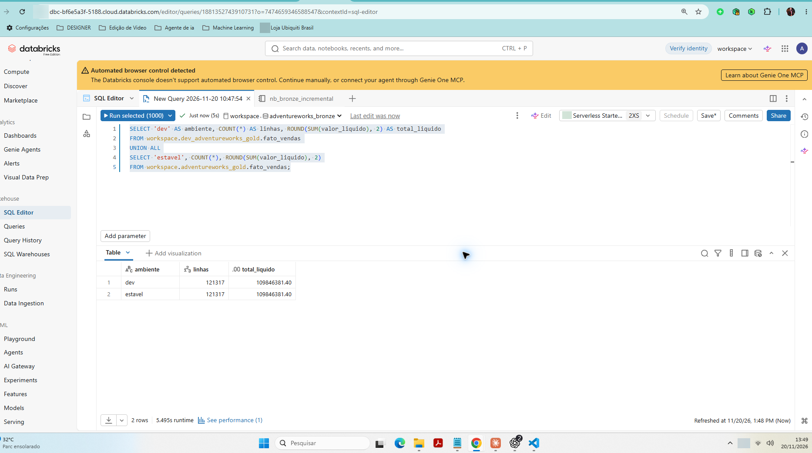

Detalhes do fluxo: [docs/cicd.md](docs/cicd.md).

---

## 5. Teste de ponta a ponta

Uma alteração de **10 unidades** no item 13 do pedido 43660 (preço 419,4589, sem desconto) foi feita na origem e acompanhada até a ouro.

| Etapa | Resultado |
|---|---|
| Receita na ouro antes | 109.846.381,40 |
| Alteração na origem | subtotal do pedido de 1.294,25 para 5.488,84 |
| Data Factory | 73 atividades com sucesso |
| Staging no Azure | item e pedido com a data da alteração |
| Job Databricks | bronze, prata e ouro com sucesso, validação aprovada |
| **Receita na ouro depois** | **109.850.575,99**, igual ao valor calculado |

| Antes | Depois |
|---|---|
| 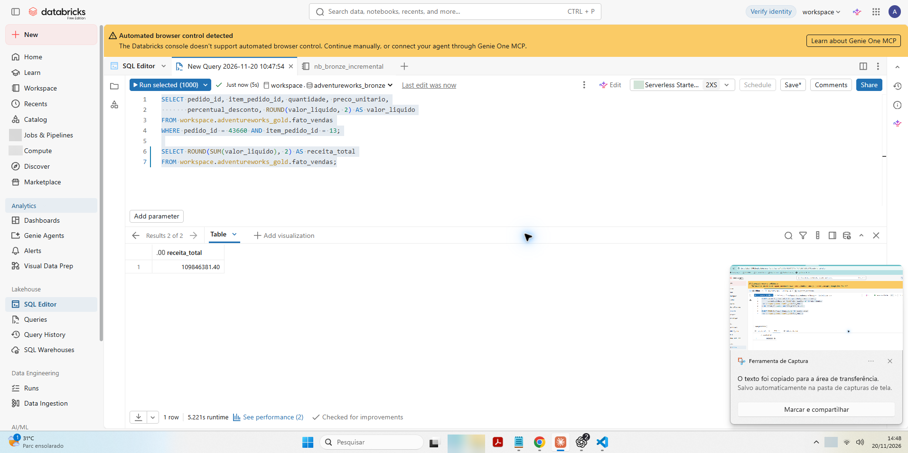 | 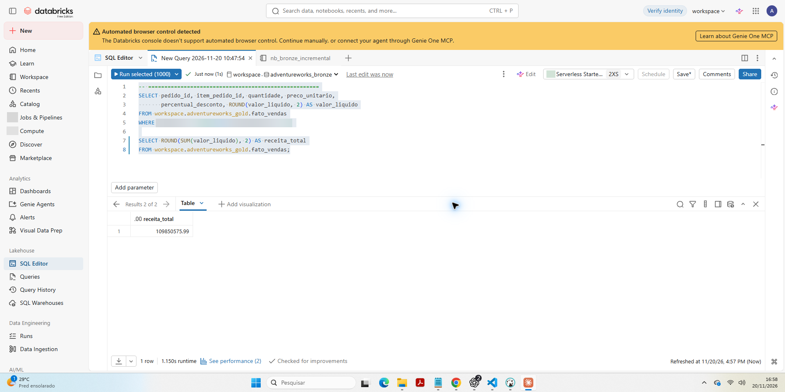 |

Relatório completo: [docs/teste_ponta_a_ponta.md](docs/teste_ponta_a_ponta.md).

---

## 6. Camada financeira e dashboard no Grafana

O notebook `nb_gold_financeiro` acrescenta à fato de vendas o **custo padrão vigente na data do pedido**, pelo histórico de custos do produto, e calcula custo total, lucro bruto e margem. Gera a `fato_financeiro_vendas` (grão de item), o `agg_financeiro_diario` e a view `vw_financeiro_mensal`, com validação automática contra a fato de vendas.

| Indicador | Valor |
|---|---|
| Receita líquida | US$ 109,8 milhões |
| Custo | US$ 97,3 milhões |
| Lucro bruto | US$ 12,6 milhões |
| Margem bruta | 11,4% |
| Itens com custo histórico | 100% |

O dashboard roda no **Grafana Cloud** e consulta a camada ouro pela **API SQL Statement Execution** do Databricks, com o plugin **Infinity**, um token restrito e uma lista de hosts permitidos. A definição do dashboard fica versionada em [`grafana/`](grafana/).

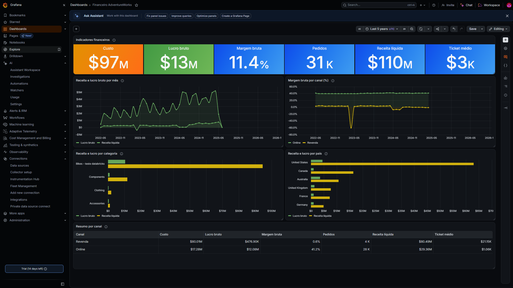

**Principal leitura:** a revenda gera 73% da receita (US$ 80,5 milhões), mas tem margem de apenas 0,6%, com meses negativos; o canal online, com US$ 29,4 milhões, tem margem de 41,2% e gera quase todo o lucro.

---

## Estrutura do repositório

```text
adventureworks-lakehouse/
├── adf/                    # recursos do Data Factory (integração Git do ADF)
├── databricks/
│   ├── databricks.yml      # bundle e alvos dev e prod
│   ├── resources/          # definição do job
│   └── src/                # notebooks bronze, prata e ouro + utils
├── sql/azure/              # scripts do Azure SQL
├── tests/                  # testes das transformações (pytest)
├── grafana/                # dashboard financeiro (JSON)
├── docs/                   # guia, relatórios e evidências
└── .github/workflows/      # CI e CD
```

---

## Decisões técnicas

- **Carga orientada por metadados**: uma tabela de controle em vez de um pipeline por tabela.
- **Marco próprio em cada camada**: a bronze não depende do marco do Data Factory; cada camada sabe até onde já leu.
- **`>=` no filtro incremental**: evita perder linhas com a mesma data; o `MERGE` torna o reprocessamento inofensivo.
- **Validação na ouro**: o pipeline falha se os totais não baterem, em vez de publicar números errados.
- **Ambientes por schema**: a Free Edition permite um workspace; a separação é feita por schema e por alvo do bundle.
- **Usuário somente leitura** na federação, com senha fora do código; segredos de automação no GitHub.

## Limitações conhecidas

- A marca d'água não captura exclusões nem alterações sem atualização do `ModifiedDate` (evolução: CDC).
- O ForEach do Data Factory roda em sequência; o custo fixo por atividade domina o tempo.
- Regra de firewall aberta e token pessoal no CI são aceitáveis só em laboratório.

## Próximos passos

- Agendar o job após o Data Factory ou acioná-lo pela API ao fim da ingestão.
- Detecção de mudança de esquema na origem, com alerta e roteiro de correção.
- Painel de observabilidade do pipeline no Grafana (execuções, tempos e falhas).
- Ingestão de APIs públicas (Banco Central, Portal da Transparência) num Azure Data Lake Storage Gen2.
- Power BI sobre o modelo estrela.

## Documentação

- [Guia completo do projeto, passo a passo](docs/guia_completo_projeto.md)
- [Fase 1: ingestão incremental com Azure Data Factory](docs/ingestao_adf.md)
- [Fluxo de desenvolvimento e CI/CD](docs/cicd.md)
- [Teste de ponta a ponta](docs/teste_ponta_a_ponta.md)
- [Todas as evidências](docs/evidencias/)

---

**Autor:** [Alex Alves](https://github.com/AlexAlvesInacio)
