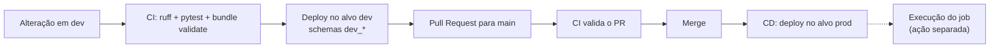

# Fluxo de desenvolvimento e CI/CD

## Branches

| Branch | Finalidade |
|---|---|
| `dev` | Desenvolver e testar mudanças |
| `main` | Versão estável, recebe mudanças somente por Pull Request |

## Fluxo

Publicar o bundle atualiza notebooks e a definição do job, mas não executa a carga.

## Ambientes no mesmo workspace

A Free Edition permite um workspace por conta, então a separação é feita por schema:

| Alvo do bundle | Schemas | Nome do job |
|---|---|---|
| `dev` | `dev_adventureworks_bronze`, `dev_adventureworks_silver`, `dev_adventureworks_gold` | `[dev usuário] job_lab_adventureworks` |
| `prod` | `adventureworks_bronze`, `adventureworks_silver`, `adventureworks_gold` | `job_lab_adventureworks` |

Os notebooks recebem catálogo e schemas por parâmetros do job (widgets), definidos em `databricks/databricks.yml`.

## Configuração inicial (uma vez)

1. Instalar a Databricks CLI e autenticar localmente: `databricks auth login --host https://dbc-bf6e5a3f-5188.cloud.databricks.com`.
2. Vincular o job existente ao bundle, para o primeiro deploy em prod atualizar o job atual em vez de criar outro:
   `cd databricks && databricks bundle deployment bind job_lab_adventureworks 10336806461856 -t prod`
3. Validar localmente: `databricks bundle validate -t dev`.
4. No GitHub, em **Settings > Secrets and variables > Actions**, criar os segredos `DATABRICKS_HOST` e `DATABRICKS_TOKEN`.
5. Em **Settings > Environments**, criar o ambiente `prod` (permite exigir aprovação antes do deploy).
6. Em **Settings > Branches**, proteger a `main`: exigir Pull Request e CI aprovado antes do merge.

## Autenticação da automação

A recomendação da Databricks é usar service principal com federação de identidade (sem segredo armazenado).
Na Free Edition, essa opção deve ser validada antes; como alternativa de laboratório, usar um token de acesso pessoal
com validade curta, guardado apenas nos segredos do GitHub.
