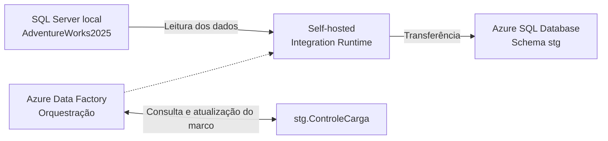
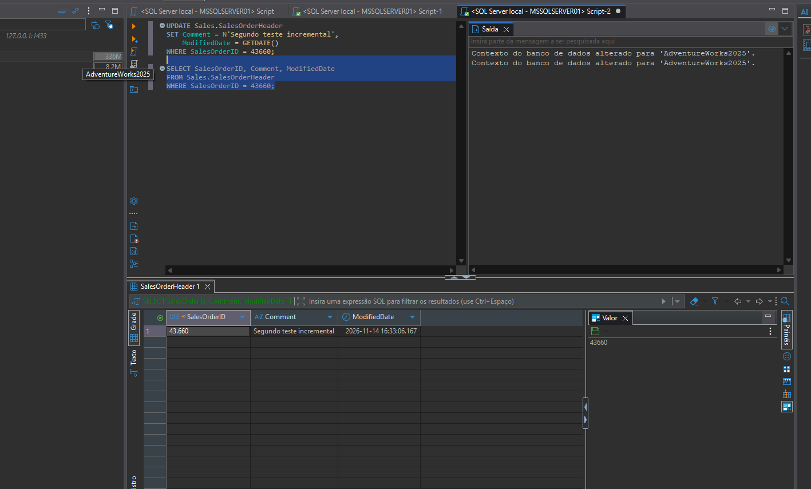
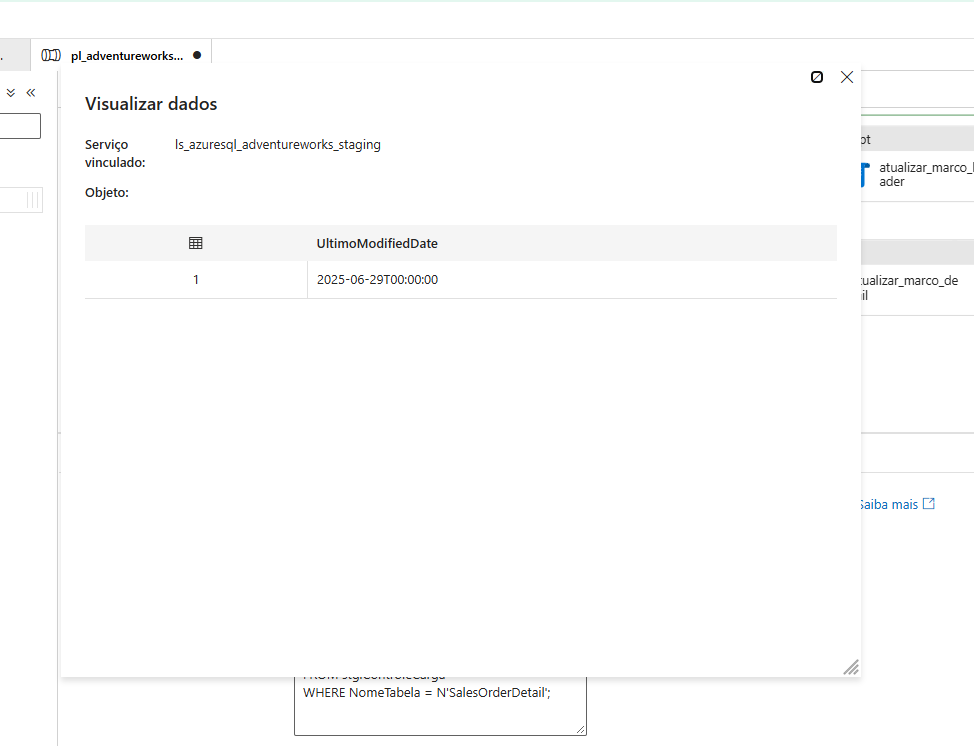
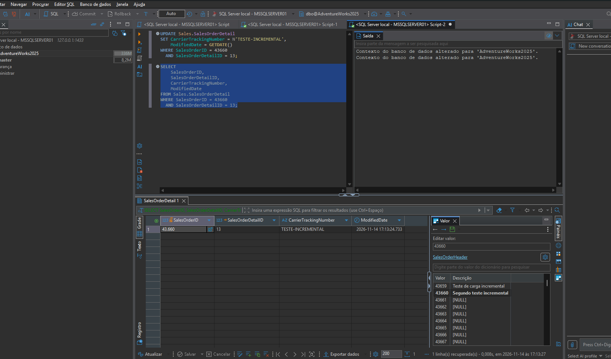

# Ingestão incremental com Azure Data Factory (fase 1)

**SQL Server local → Azure SQL Database · AdventureWorks**

Laboratório de engenharia de dados desenvolvido por **Alex Alves** para carregar pedidos e itens de pedidos de um SQL Server local para uma camada de staging no Azure. A solução combina carga inicial, seleção incremental por data de modificação e upsert no destino.

O teste completo confirmou a transferência de uma alteração, a atualização do marco de processamento e uma nova execução com zero linhas copiadas quando a origem permaneceu sem mudanças.

## Arquitetura



O Data Factory coordena as atividades. O Self-hosted Integration Runtime permite acessar a origem local e executar a movimentação dos dados. No Azure SQL, as tabelas de staging recebem os registros e a tabela de controle armazena o último marco processado de cada tabela.

## Tecnologias e escopo

| Componente | Uso no laboratório |
|---|---|
| SQL Server e AdventureWorks2025 | Origem dos pedidos e dos itens |
| Azure Data Factory | Pipelines, dependências, consultas e cópias |
| Self-hosted Integration Runtime | Conectividade com a origem local |
| Azure SQL Database | Staging e controle de carga |
| T-SQL | Filtros incrementais, atualização do marco e validação |
| DBeaver | Consultas e alterações controladas na origem |

| Origem | Destino | Chaves configuradas no upsert |
|---|---|---|
| `Sales.SalesOrderHeader` | `stg.SalesOrderHeader` | `SalesOrderID` |
| `Sales.SalesOrderDetail` | `stg.SalesOrderDetail` | `SalesOrderID`, `SalesOrderDetailID` |

O escopo desta entrega contempla essas duas tabelas. A ingestão parametrizada das demais tabelas e as transformações com Databricks serão desenvolvidas em um projeto separado.

## Pipelines implementados

### Carga inicial

O pipeline `pl_adventureworks_carga_inicial` realiza a carga das tabelas de origem para o staging. Essa etapa estabelece a base utilizada nos testes incrementais.

### Carga incremental

O pipeline `pl_adventureworks_incremental` contém oito atividades. Primeiro processa Header; após o sucesso desse fluxo, processa Detail. As dependências entre atividades utilizam a condição de sucesso.

| Etapa | Header | Detail |
|---|---|---|
| Ler o marco salvo no Azure | `lookup_marco_header` | `lookup_marco_detail` |
| Consultar o maior `ModifiedDate` na origem | `lookup_novo_marco_header` | `lookup_novo_marco_detail` |
| Copiar o intervalo com upsert | `copy_sales_order_header_incremental` | `copy_sales_order_detail_incremental` |
| Atualizar o marco após a cópia | `atualizar_marco_header` | `atualizar_marco_detail` |

Para cada tabela, a seleção utiliza o intervalo:

```sql
WHERE ModifiedDate > @MarcoAnterior
  AND ModifiedDate <= @NovoMarco
```

Esse trecho representa a regra do filtro. No pipeline, os valores são obtidos pelos Lookups e inseridos na consulta por uma expressão dinâmica com `@concat` e conversão de data no formato ISO 8601.

O limite superior é capturado antes da cópia. Após o sucesso da atividade, o Script grava esse mesmo valor em `stg.ControleCarga`. O destino usa upsert para atualizar registros que correspondam às chaves configuradas ou inserir registros novos.

## Configuração utilizada

O ambiente inclui um grupo de recursos, um servidor lógico com Azure SQL Database, uma instância do Data Factory e um Self-hosted Integration Runtime registrado na máquina com acesso ao SQL Server local.

Foram configurados dois serviços vinculados: um para a origem SQL Server e outro para o Azure SQL de staging. A identidade gerenciada do Data Factory recebeu permissões no destino para as operações utilizadas no laboratório.

| Dataset | Objeto associado |
|---|---|
| `SqlServerTable1` | `Sales.SalesOrderHeader` na origem |
| `SqlServerTable2` | `Sales.SalesOrderDetail` na origem |
| `AzureSqlTable1` | `stg.SalesOrderHeader` no destino |
| `AzureSqlTable2` | `stg.SalesOrderDetail` no destino |
| `AzureSqlTable3` | `stg.ControleCarga` no destino |

Os Lookups usam a opção de retornar somente a primeira linha. As cópias incrementais usam **Executar upsert**, **Usar tempdb** e tabelas existentes. As atividades Script de atualização do marco usam **NonQuery**.

## Evidências do laboratório

As imagens abaixo são capturas originais selecionadas do laboratório. Os resultados de execução na tabela de testes foram transcritos das saídas do ADF compartilhadas durante a validação.

### 1. Alteração de um pedido na origem

O pedido `43660` recebeu o comentário `Segundo teste incremental` e um novo `ModifiedDate`. A alteração foi usada para testar o fluxo de Header.



### 2. Leitura do marco de Detail

Antes da alteração de teste, o Lookup de controle retornou `2025-06-29T00:00:00` para `SalesOrderDetail`.



### 3. Alteração de um item na origem

O item `13` do pedido `43660` recebeu `CarrierTrackingNumber = TESTE-INCREMENTAL` e `ModifiedDate = 2026-11-14 17:13:24.733`.



### Resultados verificados

| Teste | Resultado observado |
|---|---|
| Alteração controlada em Header | 1 linha lida e 1 linha copiada; sem erros |
| Conferência de Header no Azure | Comentário atualizado e data `2026-11-14 16:33:06.167` |
| Reexecução de Header sem mudanças | 0 linhas lidas e 0 copiadas |
| Alteração controlada em Detail | 1 linha lida e 1 linha copiada; sem erros |
| Conferência de Detail no Azure | `TESTE-INCREMENTAL`; `ModifiedDate` e marco salvo iguais a `2026-11-14 17:13:24.733` |
| Reexecução de Detail sem mudanças | 0 linhas lidas e 0 copiadas; sem erros |
| Execução do pipeline completo | Oito atividades concluídas com sucesso |
| Publicação no Data Factory | Publicação concluída com sucesso |

A validação de conteúdo foi feita por consultas SQL. O campo `dataConsistencyVerification` das saídas do ADF estava como `NotVerified`; portanto, os resultados acima não representam uma verificação automática de consistência de toda a base.

## Consulta de validação no destino

Executada no Azure SQL de staging, esta consulta confere o item alterado e o marco associado à tabela:

```sql
SELECT
    d.SalesOrderID,
    d.SalesOrderDetailID,
    d.CarrierTrackingNumber,
    d.ModifiedDate,
    c.UltimoModifiedDate AS MarcoSalvo
FROM stg.SalesOrderDetail AS d
CROSS JOIN stg.ControleCarga AS c
WHERE d.SalesOrderID = 43660
  AND d.SalesOrderDetailID = 13
  AND c.NomeTabela = N'SalesOrderDetail';
```

## Decisões e limites do exercício

- Cada tabela mantém seu próprio marco de processamento.
- A chave de Header identifica um pedido; as chaves de Detail identificam o item do pedido.
- O marco só é atualizado após o sucesso da cópia correspondente.
- O teste sem mudanças demonstra que os registros já processados ficaram fora da próxima seleção incremental.
- A estratégia depende de `ModifiedDate` ser atualizado na origem. Exclusões físicas e mudanças com datas anteriores ou iguais ao marco não são capturadas por esse filtro.
- Os testes foram realizados com alterações controladas e execuções sequenciais. Concorrência, mudanças de esquema e recuperação de falhas durante a carga não foram validadas neste exercício.

## Conteúdo disponível

```text
adventureworks-adf-ingestion/
├── README.md
└── images/
    ├── header-alteracao-origem.png
    ├── detail-marco-inicial.png
    └── detail-alteracao-origem.png
```

Esta versão contém a documentação e as imagens. Os JSONs reais dos pipelines, datasets e serviços vinculados, os scripts completos de preparação e o roteiro detalhado de infraestrutura ainda serão adicionados. O pacote atual não constitui uma implantação automatizada do ambiente.

Na preparação dos arquivos para publicação, credenciais e chaves de registro do Integration Runtime devem ficar fora do repositório. As imagens incluídas foram selecionadas por não exibirem e-mail ou identificadores da assinatura Azure.

---

**Autor:** [Alex Alves](https://github.com/AlexAlvesInacio)
